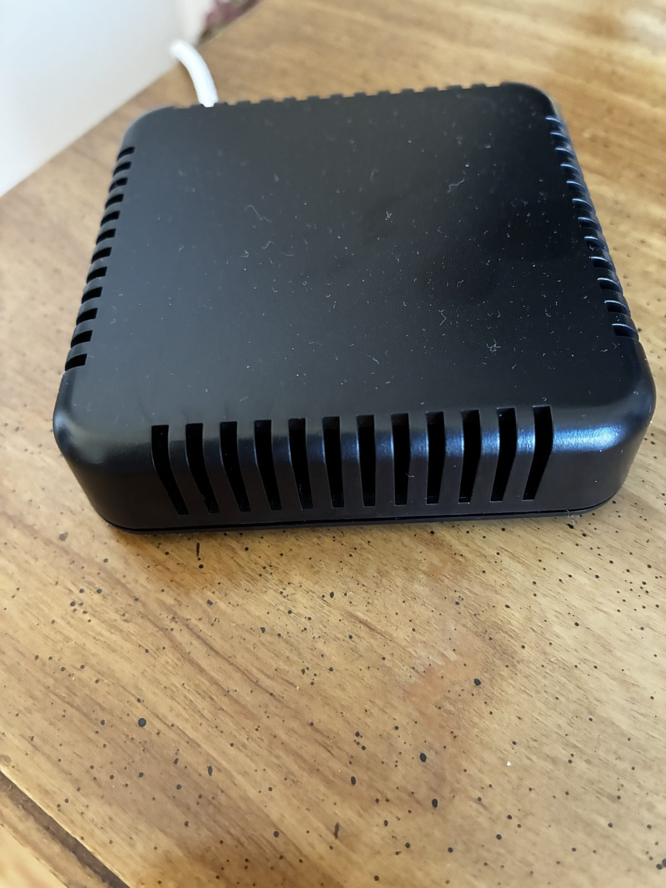
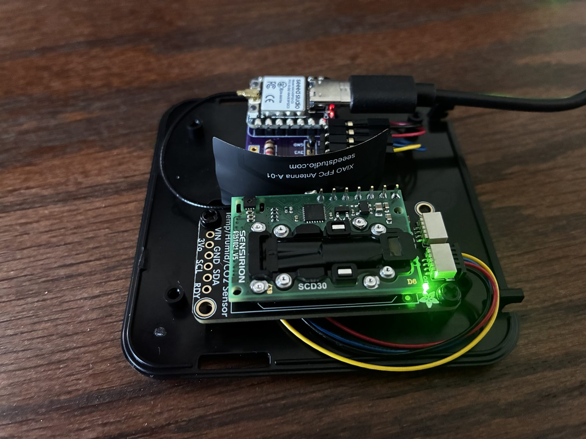
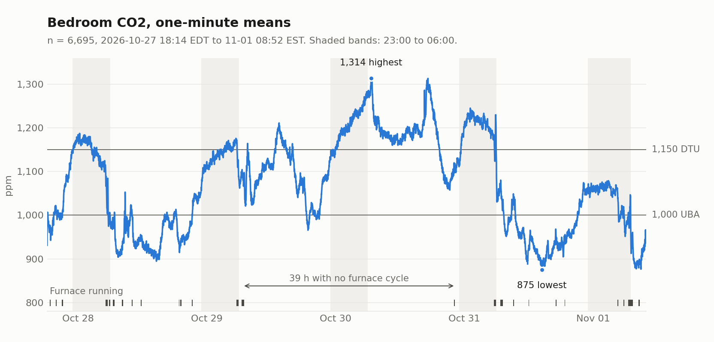
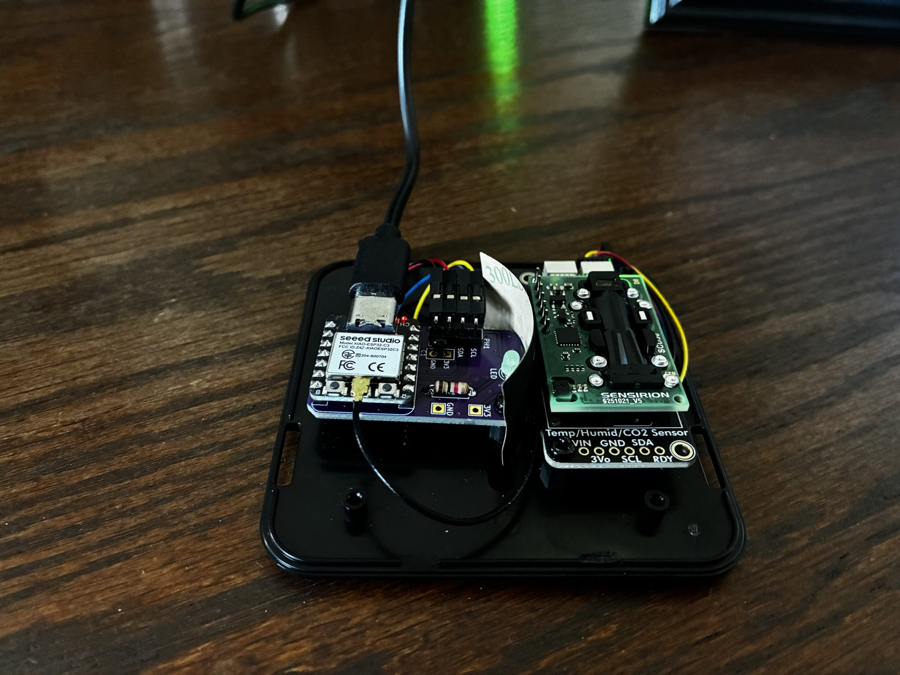
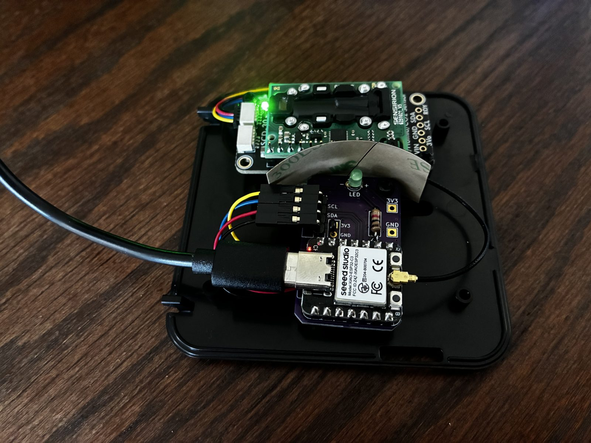
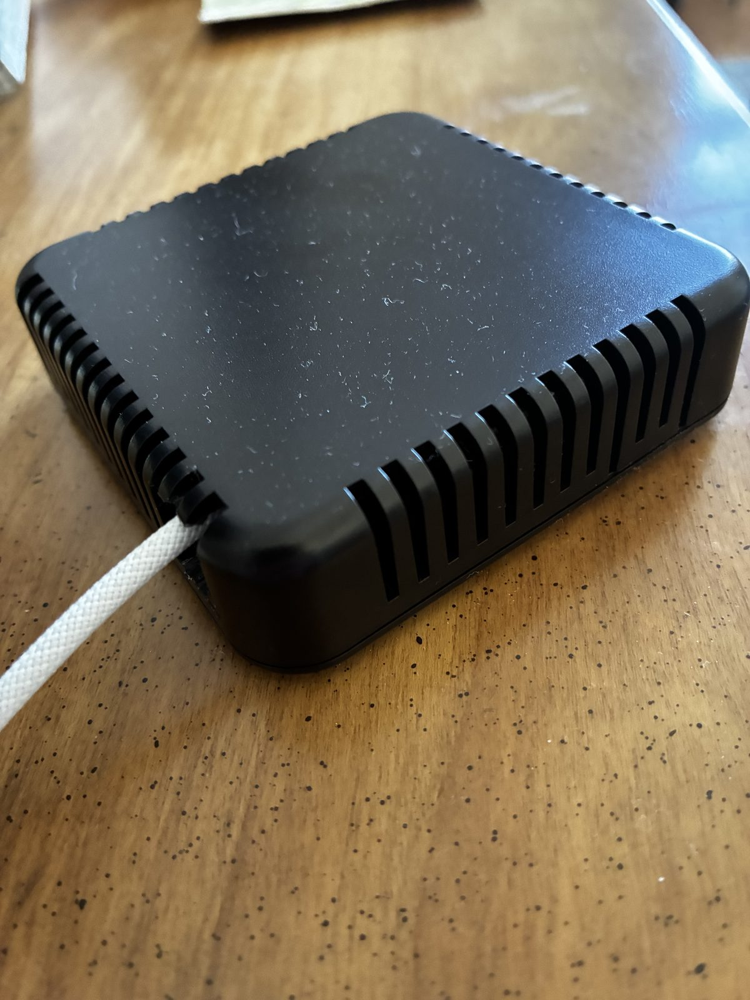
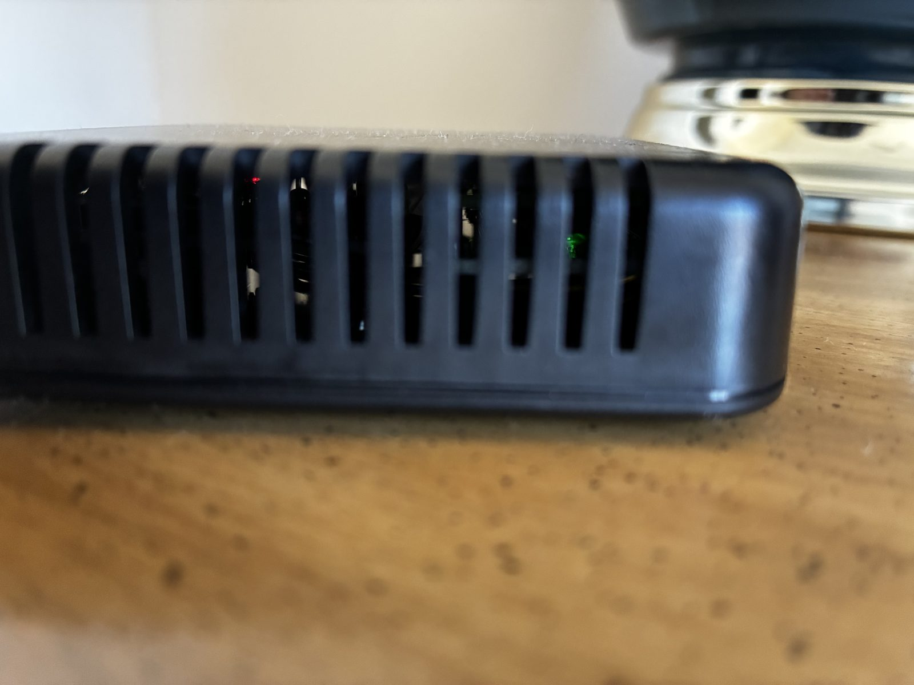

<div align="center">

# CO2 Monitor

**NDIR CO2 Sensing for Two Rooms, Built to Fail Visibly**

[](LICENSE-HARDWARE)
[](LICENSE-CODE)
[](LICENSE)
[](#status)
[](https://github.com/sponsors/wkcollis1-eng)

</div>

Two CO2 nodes, one in a bedroom and one in a family room. Each pairs an **Adafruit
SCD30** (PID 4867, a Sensirion NDIR sensor) with a **Seeed XIAO ESP32-C3** on a
small carrier board, inside a **Hammond 1551V4** enclosure. They run **ESPHome**
and report to **Home Assistant**. The bedroom node is built and running; the
family-room node is not built yet.

All behaviour lives in one file, [`esphome/co2-node-common.yaml`](esphome/co2-node-common.yaml).
Each node file holds nothing but its name and its own API key.

<p align="center">
  
  
</p>

*The bedroom node as built: closed on 2026-11-01, and open on 2026-10-27, just
after its USB flash to firmware 1.1 [M: photo EXIF]. More photos are under
[As built](#as-built), and the first five nights of data are under
[Field results](#field-results-the-first-five-nights).*

---

## The problem this is built for

> It is 03:00 in a closed bedroom. The SCD30's cable worked loose an hour ago.
> Nobody is awake to notice, and nobody is coming to fix it tonight.

A CO2 sensor that has stopped answering is dangerous in one specific way: Home
Assistant keeps showing the last good number, and a flat, healthy-looking reading
is exactly what a dead sensor looks like. The acceptance test is **what the node
reports at that moment**, not whether it is online. The firmware is built around
three such moments, named in the header of the common file:

1. **Every boot.** ESPHome 2026.9.1 turns the SCD30's automatic self-calibration
   (ASC) **on** by default and writes that setting to the sensor at every boot
   [S: ESPHome 2026.9.1 source, `scd30/sensor.py:65`, `scd30/scd30.cpp:91`]. ASC
   assumes the sensor regularly sees fresh outdoor air. A closed room in a house
   with no HRV or ERV never does, so ASC would walk the baseline upward where
   nobody would see it. It is turned off explicitly.
2. **Power-up.** The SCD30's first reading after power-up is 0 ppm
   [S: `docs/adafruit-scd30.pdf` p10, p16], and ESPHome passes it through. A
   filter drops it. 0 ppm is not a possible indoor value, so dropping every 0
   costs nothing.
3. **The sensor stops answering.** After 240 s with no reading, the CO2 entity
   goes **unknown** and **CO2 Sensor Fault** turns on. After 900 s the node
   reboots to re-run the sensor setup, **at most three times in a row**. The
   counter survives the reboot, so a dead cable cannot turn into a reboot loop that
   hides it. After the third reboot the node stays up and keeps reporting the fault.
   (1.4: CO2 (2 s) goes unknown at 240 s; CO2, the 1-minute mean, and the SCD30
   temperature and humidity follow at the end of their minute, by 330 s.)

## Status

| | |
|---|---|
| Firmware | **Rev 1.4-draft**, 2026-10-27 (1.0-draft 2026-10-18). On the bedroom node since 2026-10-27 18:13 |
| Compile | Bedroom node, firmware 1.4: compiled on **ESPHome 2026.10.0** with 0 compiler warnings and 0 errors [M: build log, 2026-10-27; config_hash `0x664528e8`]; a deliberately broken lambda fails the same build, so the compile gate can fail. 1.0: both nodes on ESPHome 2026.9.1, 0 warnings, 0 errors [M: build logs, 2026-10-18; config_hash `0xa7e479a5` bedroom, `0xc9ec59d4` family room]. ESPHome's own advisory that an OTA password costs about 3.5 KB of flash prints for both, and is accepted |
| Watchdog | Host-simulated: the clean config passes all 224 checks, and each of the 11 injected faults is caught [M: `harness/faults.py`, 2026-10-27, firmware 1.4; 35 checks and 5 faults on 2026-10-18]. See [The watchdog harness](#the-watchdog-harness) for what that does and does not prove. On the device: SCD30 unplugged on 2026-10-27, firmware 1.1. The node logged the fault at 259 s, HA showed CO2 unknown and the fault on, and the LED strobed [M]. Not repeated on 1.4. The 900 s recovery reboot, and the strobe stopping at the next good reading, have not been seen on the device |
| Deployment | Bedroom node: in Home Assistant since 2026-10-27, firmware 1.4 [M: config_hash `0x664528e8`, ESPHome 2026.10.0, 0 warnings]. On a dresser about 10 ft from the bed [Bill]; 111.65 h with no reset to 2026-11-01 [M]. Family-room node: not built |
| Hardware | **No new PCB.** The carrier is an existing ESP32-C3 sensor-node board. The KiCad file here is that board, unchanged, with the SCD30 and the enclosure placed on it for a 3D fit check |

## Field results: the first five nights

The bedroom node ran from 2026-10-27 18:14 EDT to 2026-11-01 08:52 EST on
firmware 1.4: 111.65 h and five nights [M: InfluxDB and the HA recorder, read
2026-11-01]. That is one node in one room in late October, with outdoor
temperatures from 26.9 to 67 °F [M].



*UBA: 1,000 ppm is the line to open a window, and 2,000 ppm is unacceptable
[S: Umweltbundesamt, "Leitwerte für Kohlendioxid in der Innenraumluft" (2008),
table; not in this repository]. DTU: above 1,150 ppm in a bedroom, sleep quality
is adversely affected [S: DTU news, May 2023, "Ventilate your bedroom at night";
not in this repository].*

### Conclusions

1. **The node is reliable so far, on the healthy path.** It ran 111.65 h with no
   reset and no fault. The three longest gaps in the data were Home Assistant
   restarting, and the node's uptime ran straight through them. This window did
   not exercise the fault path: see Watchdog under [Status](#status).
2. **The room runs elevated, not extreme.** All 6,695 one-minute means were above
   800 ppm, and none reached 1,500 ppm. Four of the five nights averaged above
   1,000 ppm by more than the sensor's ±60 ppm; the fifth, at 1,042 ppm, did not.
   The two highest nights, 1,203 and 1,206 ppm, are 53 to 56 ppm over DTU's 1,150
   line [D]. That is inside ±65 ppm, so this sensor cannot place them above it.
   Nothing here ventilates on its own, so lowering a high reading means opening
   something by hand.
3. **Turning ASC off was right for this room.** The lowest minute in five days was
   874.9 ppm, 449 ppm above the 426 ppm outdoor reference [D: 874.9 − 426]. ASC
   needs regular fresh air, and this room did not reach it once in the window.
4. **CO2 tended to fall around furnace cycles, and these data cannot say why.**
   See [The furnace](#the-furnace).
5. **No firmware or configuration change follows from this.** The explanations
   below are still models, and a model does not justify changing a running node.

### The node

| Check | Result |
|---|---|
| Resets | 0. Uptime reached 401,944 s with no drop [M] |
| Fault | CO2 Sensor Fault never on, and CO2 Stale Reboots stayed 0 [M: recorder] |
| CO2 (2 s) rows | 198,331 of 200,970 expected, 98.7 % [D: 111.65 h × 1,800 per h]. A lower bound: HA records only changes, so a repeated reading leaves no row |
| Gaps over 4 s | 9. The longest, 218, 137 and 29 s, are HA restarts [M: logbook, Oct 28 22:55, Oct 29 22:04, Oct 31 11:44]. The other six are 13 s or shorter |
| CO2 as a mean | CO2 matches the mean of the previous 60 s of CO2 (2 s): error sd 0.09 ppm, largest 1.08 ppm [D: n = 1,336] |
| Reading noise | 1.04 ppm from one 2 s reading to the next [D: sd of the differences / √2, n = 198,250]. A floor, not the accuracy: neighbouring readings need not be independent |
| WiFi | −30 to −19 dBm, median −21 [M: forward-filled on a 60 s grid, n = 6,700] |
| Free heap | Median by quarter of the run: 203,604, 203,608, 203,568, 203,568 B [M: forward-filled, n = 6,699]. No leak visible over a run this short |
| Loop time | Median 24 ms in every quarter. The 281 ms maximum was at boot [M] |
| SCD30 temperature | 9.54 °F above the upstairs thermostat, sd 0.35 [D: n = 1,219, from 10 h after boot]. Dew points 1.23 °F apart, sd 0.45 [D]. The thermostat is not in the bedroom, so this shows the offset is steady, not how large it is |

### The room

One-minute means, n = 6,695 [M]: 874.9 to 1,313.5 ppm, mean 1,074.2, median
1,075.4. Above 1,000 ppm: 4,597, or 68.7 % [D]. Above 1,150 ppm: 2,042, or 30.5 %
[D]. Above 1,500 ppm: 0.

| Night, 23:00 to 06:00 | n | Mean, ppm | Lowest | Highest | Highest 2 h mean |
|---|---|---|---|---|---|
| Oct 27-28 | 419 | 1,137 | 975 | 1,188 | 1,173 |
| Oct 28-29 | 420 | 1,135 | 1,063 | 1,176 | 1,160 |
| Oct 29-30 | 420 | 1,206 | 1,127 | 1,283 | 1,250 |
| Oct 30-31 | 420 | 1,203 | 1,084 | 1,245 | 1,226 |
| Oct 31-Nov 1 | 480 | 1,042 | 951 | 1,079 | 1,068 |

The last night is 8 h because the clocks went back. The run's highest minute,
1,313.5 ppm, came at 06:37 on Oct 30, just after that night's window closed.

### The furnace

On four of the five mornings a long furnace cycle started between 05:06 and 05:32,
and CO2 was 95 to 139 ppm lower 15 min after it ended [M]. The fifth morning had no
cycle: CO2 kept climbing until 06:37 and set the run's highest minute [M]. That
morning sits inside the longest span without a cycle, 39.07 h from Oct 29 06:58 to
Oct 30 22:02, when CO2 averaged 1,150 ppm [M: n = 2,344].

| Day | CO2 mean, ppm | Furnace cycles | Furnace minutes | Outdoor mean, °F |
|---|---|---|---|---|
| Oct 28 | 1,009 | 9 | 117 | 42.2 |
| Oct 29 | 1,103 | 2 | 51 | 50.7 |
| Oct 30 | 1,191 | 1 | 10 | 55.0 |
| Oct 31 | 1,029 | 6 | 87 | 46.8 |

Across all 25 cycles, CO2 moved by a median of −10.2 ppm in the 25 min from the
start of a cycle, against +3.1 ppm in 196 non-overlapping 25 min windows clear of
the furnace. The difference is −13.3 ppm, one-sided permutation p = 0.0027 [D:
20,000 permutations]. That test treats the windows as independent and does not
hold time of day constant, and 10 of the 25 cycles started between 04:00 and
08:00 [M]. Nor was the fall prompt or uniform: 7 cycles ended the 25 min higher
than they began, and the longest, 52.5 min on Nov 1, was 47 ppm up at 25 min and
95 ppm down 15 min after it ended [M].

So the link held in this window, but its cause is not known. Three explanations
fit [I]: the blower mixes bedroom air with the rest of the house; warm days need
less furnace and also push less air through the house; or people get up at about
the same hour. Four days cannot separate them, because furnace minutes and outdoor
temperature move together. The family-room node can test the first: blower mixing
would pull the two rooms together during a cycle [I: falsified if the gap between
them holds through cycles].

### What this does not establish

- **The absolute level.** The only reference is the porch FRC of 2026-10-27, at
  an assumed 426 ppm [I], and nothing has checked the node since: no second
  instrument and no outdoor re-check [M]. If the porch air was above 426 ppm, the
  FRC set the node low, so that error would make these readings too low, not too
  high [I: falsified by a reference meter reading below the node]. Accuracy is
  ±(30 ppm + 3 %) [S: SCD30 Interface Description v1.0-D1, p1], or ±60 ppm at
  1,000 and ±65 ppm at 1,150 [D].
- **Who was in the room.** Who slept there and whether the door was open were not
  logged night by night, so the differences between nights have no explanation
  here.
- **The air at the bed.** The node sits on a dresser about 10 ft from the bed
  [Bill]. These are readings at one point in the room, not in the breathing zone.
- **The rest of the house.** Whether the bedroom is worse than other rooms needs
  the family-room node.
- **Winter.** Five days in late October say nothing about January, when the
  furnace runs far more and the windows stay shut.

## Repository layout

```
esphome/    Node firmware: co2-node-common.yaml plus one thin file per node
harness/    Host-side simulation of the watchdog lambdas, and its fault injector
hardware/   KiCad 10 board (fit-check model) and footprint library
  CO2 Monitor_*.png   The two 3D renders in Fit in the enclosure
  as-built/           Photographs of the bedroom node, and the field-results chart
  3d/                 Vendor 3D models: SCD30, XIAO ESP32-C3, USB-C plug
  adafruit-scd30/     Adafruit's EAGLE files for the SCD30 breakout, with their licence
  Seeed_XIAO_ESP32C3/ KiCad redraw of the XIAO's schematic, for net checking
docs/       Vendor primary sources: Hammond drawing, Sensirion and Adafruit
            SCD30 documents, Seeed XIAO schematic
```

## Hardware

| | |
|---|---|
| Carrier | 23.0 × 38.0 mm, 2-layer, 1.6 mm [M: the board file] |
| MCU | Seeed XIAO ESP32-C3 |
| Sensor | Adafruit SCD30 breakout (PID 4867), I2C address `0x61`. The only device on the bus |
| I2C | SDA GPIO6 (D4), SCL GPIO7 (D5), **50 kHz** [S: `docs/adafruit-scd30.pdf` p15-16] |
| Status LED | GPIO20 (D7), the carrier's green LED. From 1.1 it is the fault light: a 5 Hz strobe on CO2 Sensor Fault, dark otherwise. The vent slots let it show |
| Antenna | Seeed FPC antenna on the XIAO's u.FL socket, marked "XIAO FPC Antenna A-01" [M: photo] |
| Enclosure | Hammond 1551V4, 80 × 80 × 20.3 mm ABS [S: `docs/1551V4BK.pdf`] |

### PH1: sensor header

The SCD30 is cabled from its STEMMA QT socket to PH1, a 1x04 right-angle header.
No header is soldered to the SCD30.

| PH1 pad | Signal | QT wire |
|---|---|---|
| 1 | GND | black |
| 2 | +3V3 | red |
| 3 | SDA | blue |
| 4 | SCL | yellow |

> **Pad 2 is the square pad, not pad 1.** Count from the square pad and you will
> put 3V3 on the wrong wire. Place each wire by colour.

**Feed the breakout from 3V3, never 5 V.** The breakout's 10K SDA and SCL
pull-ups go to VIN [S: `hardware/adafruit-scd30/Adafruit SCD30.brd` netlist], so
VIN sets the high level that the XIAO's 3.3 V pins see on the bus.

### Fit in the enclosure

The 1551V4 is 15.30 mm deep inside, floor to cover [S: Hammond drawing, Section
A-A]. Both boards sit on standoffs on the enclosure floor, not on its bosses.
Figures marked [D] are arithmetic on dimensions measured from the vendor STEP
models:

- **The SCD30 is the tight part.** On 6 mm standoffs it clears the cover by
  0.735 mm nominal [D]. The sensor's height tolerance is ±0.70 mm [S: Sensirion
  SCD30 datasheet, Table 6], and the cover's moulded lettering stands 0.20 mm
  [M: cover STEP], so the worst case is a clash under the lettering. On 5 mm
  standoffs the worst case is 1.035 mm to the cover, or 0.835 mm under the
  lettering [D: 1.035 − 0.20]. The SCD30's standoff height is the open fit
  question.
- **The carrier** on 6 mm standoffs: a XIAO soldered in on pin headers leaves
  0.95 mm [D]. A socketed XIAO does not fit. The mounting screw under the
  XIAO has to go in before the XIAO does.
- The floor has a 1.0 mm recess at its centre, ±7.53 mm [M: base STEP]. Keep
  standoffs off it.

**As built:** the cover closes over both boards [M: photos below]. That shows the
stack fits, not how much clearance is left, and the standoff height used is not
recorded here yet. The USB cable leaves through a notch at a corner of the vent
slots, which the model does not show.


*KiCad 3D renders of the fit-check model in `hardware/`, not photographs. The
model's standoff height is not final.*

### As built

<p align="center">
  
  
</p>
<p align="center">
  
  
</p>

*Top row: 2026-10-27. Bottom row: 2026-11-01 [M: photo EXIF].*

**Steady green through the slots is not a fault.** It is the breakout's own LED,
and the steady red is the XIAO's, marked CH. Both are lit in the open photos while
the carrier's LED is dark. The carrier's LED is the fault light. It is also green,
but it strobes at 5 Hz.

## Firmware

[`esphome/co2-node-common.yaml`](esphome/co2-node-common.yaml) holds all the
behaviour. [`bedroom-co2-node.yaml`](esphome/bedroom-co2-node.yaml) and
[`family-room-co2-node.yaml`](esphome/family-room-co2-node.yaml) hold only
`substitutions`, their own API encryption key, and the `packages:` include. Both
nodes therefore run the same behaviour from one copy, and a fix made once
reaches both.

### Entities

| Entity | Kind | Notes |
|---|---|---|
| CO2 | sensor, ppm | The 1-minute mean of CO2 (2 s), sent once a minute (1.4; to 1.3, the 60 s reading). **Unknown** at the end of the minute in which CO2 (2 s) goes unknown |
| CO2 (2 s) | sensor, ppm | Every reading, every 2 s. **Unknown** when the sensor has been silent for 240 s. Added in 1.4. Up to 43,200 states a day in the recorder [D: 86,400 / 2]; fewer when readings repeat, since HA records only changes |
| CO2 Sensor Fault | binary_sensor, problem | On from 240 s of silence until the next good reading |
| CO2 Stale Reboots | sensor, diagnostic | Recovery reboots in a row, 0 to 3. Cleared by a good reading |
| Node Status, WiFi Signal, Uptime, Free Heap, Loop Time | diagnostics | |
| Node ESPHome Version, Reset Reason | diagnostics | |
| Node Restart | button | |
| LED Test | button, config | Strobes the LED for 15 s, to prove the LED and that it can be seen. Added in 1.1 |
| Calibration | text, diagnostic | 1.4: `2 s rate; FRC wait (2 min after boot)`, then `2 s rate; FRC ready`, plus the last result; sent only when it changes. (1.2-1.3: `60 s rate`, or the window's `wait` / `ready`.) Added in 1.2 |
| SCD30 Temperature (self-heated), SCD30 Humidity (self-heated) | sensor, diagnostic | The SCD30's own on-board sensor; it reads warm and dry, so it is not the room's T/RH. 1-minute means from 1.4. **Unknown** with CO2 when the sensor is silent. Added in 1.3 |

**The LED is a fault light (1.1, 2026-10-27).** It strobes at 5 Hz while CO2 Sensor
Fault is on, including after a recovery reboot, and is dark the rest of the time.
`harness/led.py` tests the LED lambda both ways, the way `faults.py` tests the watchdog.

**The SCD30 temperature and humidity are diagnostics, not room readings (1.3,
2026-10-27).** The SCD30 heats itself, which skews both readings [S: SCD30
Interface Description v1.0-D1, p15], and the rooms already have their own T/RH
sensors. Firmware 1.0 to 1.2 left them out for that reason. 1.3 adds them
because calibration assumes the sensor is at the temperature of the air it
reads [S: SCD30 Design-In Guidelines D1, p2], and this is the only way to see
that it is.

### Settings that matter

| Setting | Value | Why |
|---|---|---|
| `automatic_self_calibration` | `false` | Moment 1 above |
| `filters: filter_out` | `0.0` | Moment 2 above |
| `altitude_compensation` | `157m` | House elevation about 515 ft [D: 515 × 0.3048 = 156.97 m] |
| `update_interval` | `2s` | 1.4 (was `60s`): the rate FRC is taken at; see below. The watchdog's 240 s is about 120 missed reads |
| `copy` + `throttle_average` | `60s` | 1.4: CO2 is the 1-minute mean of CO2 (2 s); SCD30 temperature and humidity are 1-minute means too |
| `min_version` | `2026.10.0` | The version it was last compiled on. Raise it only after a recompile |

### Calibration: outdoors, by hand

With ASC off, **forced recalibration (FRC) is the only calibration path.**
Sensirion's ±50 ppm lifetime drift figure holds only with ASC or FRC in use
[S: Sensirion SCD30 datasheet v1.0-D1, Table 1, p2; not in this repository].
The node exposes one API action, `forced_recalibration(reference_ppm)`
(1.4; 1.2 and 1.3 also had `frc_prepare`, removed with the 60 s rate):

1. Take the node outdoors, or to an open window in steady air.
2. Leave it powered and reading there for several minutes.
3. Check that Calibration reads `2 s rate; FRC ready`. Sensirion requires a
   2 s measurement rate for at least two minutes before FRC [S: SCD30
   Interface Description v1.0-D1, p14]. From 1.4 the node always measures
   at 2 s, so that holds from 2 min after every boot; before then Calibration
   reads `2 s rate; FRC wait (2 min after boot)`. (1.2-1.3: call `frc_prepare`
   first and wait for its window's `ready`.)
4. At `ready`, and only when the last 3 minutes are flat, call
   `forced_recalibration` with the outdoor reference. The rule used on
   2026-10-27: each minute's sd <= 5 ppm, the 3 minute means within 5 ppm
   of each other, and the 3-min mean no higher than 469 ppm [D: 426 + 43,
   the accuracy at 426 from p1]. There is deliberately no lower bound: a
   plume can only raise outdoor CO2, so a flat reading below 426 is the
   offset FRC exists to remove. The first rule had a lower bound, and it
   rejected a flat window that read about 82 ppm low (R13, CHANGELOG
   2026-10-27). Watch the SCD30 Temperature (1.3) too: the sensor should
   be near the outdoor temperature [S: SCD30 Design-In Guidelines D1, p2].
   The global background was 426.07 ppm in September 2026 [S: NOAA GML,
   Mauna Loa monthly mean, gml.noaa.gov/ccgg/trends, updated 2026-10-09].
   A local outdoor offset above that is [I] and is not used.
5. Calibration then reads `applied N ppm`, or the reason it was not.

Last applied: bedroom node, 2026-10-27 17:01, on the front porch, 426 ppm.
Before it, the 3-min mean was 340.9 ppm; afterwards the reading was 425.7
[M]. It survived the window-end reboot: "PERSIST: PASS (after - before =
-2.0 ppm, limit 43)" [M, 3 readings either side]. That the porch air was
near 426 is [I], falsified by a reference meter there reading near 341.
After 2 of 3 boots that day the first readings started low and climbed
for about 4 min [M]; judge nothing from the first 5 min after a boot.

**Correction, 2026-10-27 17:50 (R13): the cause is the measurement rate,
not the boot.** Each climb began when `frc_prepare` moved the rate from
60 s to 2 s; after the 16:53:57 OTA the 60 s readings held 278, 277 until
`frc_prepare` at 16:55:41 [M]. Each return to 60 s did the reverse,
holding about 4 min and then falling: 340 to 279 after 16:46:26, and 454
to 379 after the 17:15:46 window-end reboot [M]. In the same air the 60 s
reading sat 60 to 70 ppm below the 2 s reading [D: 338.5 - 278, 343.0 -
277, 448.9 - 381; n = 3 transitions, one unit, one afternoon]. The
mechanism is unknown. FRC is taken at 2 s, as p14 asks, and the node runs
at 60 s, so its readings likely sit about 65 ppm below the reference [I:
falsified by the node, outdoors at 60 s and settled, reading near 426].
The PERSIST figure compared 2 s readings with 60 s readings that had not
fallen yet: it shows the calibration was not lost (at 60 s, 277 before
the FRC and 379 after it [M]), not that it is accurate. Judge nothing for
10 min after a change of rate.

**The remedy, firmware 1.4 (2026-10-27, Bill: "measure every 2 s all the
time and send HA a 1-minute average and show both on the graphs").** The
node now always measures at 2 s, the rate the FRC was taken at. Before the
OTA the bedroom read 921 ppm at 60 s, falling about 1 ppm/min [M: n = 12,
18:01-18:13]. The 2 s rate started with the 18:13:23 boot. About 2 min
later CO2 (2 s) read 1005 to 1010 [M: n = 9, 18:15], a step of about +86 ppm
[D: 1007.4 - 921.4]. The 1-minute means were 931.1, 995.4, 1006.5 and 999.4
[M: 18:14:24 to 18:17:24]; the first one held the climb, as the earlier
switches did. The settled means are +78 to +85 [D: 999.4 - 921.4; 1006.5 -
921.4]. The prediction, stated before the OTA, was +60 to 70 [I]. The
direction held and the step came out larger. One switch, one room, one
evening; who was in the room was not recorded.

(1.2-1.3) The window ends with a reboot 20 min after `frc_prepare`. Setup writes the
60 s rate back, because the SCD30 keeps its interval in non-volatile memory
[S: same document, p9]; a forgotten window cannot leave it at 2 s.
From 1.4, setup writes 2 s at every boot in the same way.

The node refuses a call before `ready` (1.4: in the first 2 min after a
boot), or a reference outside 400 to
2000 ppm, and Calibration shows the refusal. The time check runs first,
so a test call with 399 can never apply.
**Never call it from an automation.** A reference given indoors bakes the
room's excess CO2 into every later reading.

### The watchdog

A 30 s interval measures the age of the last good reading. It uses unsigned
arithmetic, so it survives the 49-day `millis()` wrap.

| Age of last reading | Action |
|---|---|
| 240 s | CO2 goes unknown, CO2 Sensor Fault turns on, a warning is logged |
| 900 s | Recovery reboot, if fewer than 3 in a row so far. The count is stored in flash, so it survives the reboot |
| after the 3rd reboot | No more reboots. The node stays online, reporting the fault |

A recovery boot starts with the fault still on, so Home Assistant never sees a
"healthy" gap between reboots. The first good reading clears the fault and the
count. Why 240 s: four missed 60 s reads always raise the fault, and three can,
if a 30 s tick lands just before the fourth read is due. After boot, the dropped 0 ppm reading comes
at about 60 s and the first real one at about 120 s, which leaves about 120 s of
margin [I: falsified if a boot with a working sensor logs "no SCD30 reading"].
1.4: at 2 s, 240 s is about 120 missed reads, and the first real reading comes
at about 4 s, so the boot margin is about 236 s [I: same falsifier]. CO2 (2 s)
goes unknown at 240 s; the 1-minute means (CO2, temperature, humidity) go
unknown at the end of the minute that holds no number, by 330 s [M: harness S2].

### Building

1. Copy the three files in `esphome/` into your ESPHome config directory.
2. Provide a `secrets.yaml` with these keys: `wifi_ssid`, `wifi_password`,
   `ap_password`, `ota_password`, `api_key_bedroom_co2_node`,
   `api_key_family_room_co2_node`.
3. Compile with ESPHome 2026.10.0 or later (the `min_version`; 1.4 was built on it). Do the first flash over USB, then
   use OTA. Logging runs over the C3's native USB Serial/JTAG, which frees GPIO20
   for the LED.

Neither node file sets `wifi: use_address` yet. Add your DHCP reservation there
if your ESPHome host cannot resolve `.local` names.

## The watchdog harness

`harness/` runs the watchdog's real lambdas on a PC, against simulated time.

- [`gen.py`](harness/gen.py) extracts the `on_boot`, `on_value` and `interval`
  lambdas **verbatim** from `co2-node-common.yaml`, and wraps them in
  [`sim.cpp.in`](harness/sim.cpp.in). The lambda text is never retyped, so the
  test runs exactly what the firmware runs.
- `sim.cpp.in` stubs `millis()` (including the 32-bit wrap), the restored
  globals, `App.safe_reboot()`, the entities and (1.4) `throttle_average`, as
  ESPHome 2026.10.0's `filter.cpp` implements it. It runs eight scenarios: healthy,
  swept over boot, tick and averaging phases;
  a late first read at about 303 s; a sensor that dies and never returns; one
  that dies and returns at 50 min; a 100 s glitch; a 600 s glitch that recovers;
  healthy across the `millis()` wrap, swept over the tick phase in 500 ms steps;
  and dead from power-up.
- [`faults.py`](harness/faults.py) proves the test can fail. It runs the clean
  config, which must PASS, then eleven single-span faults, each of which must FAIL:
  the NaN guard removed, the reboot cap raised to 4, the stale threshold cut to
  24 s, wrap-unsafe age arithmetic, a recovery boot that clears the fault, and
  (1.3) a stale SCD30 temperature or humidity left showing, or blanked while
  healthy; (1.4) a stale CO2 left showing, the NaN sent to the mean instead of
  the 2 s reading, or the 2 s reading blanked while healthy.

```
pip install ziglang pyyaml
python harness/faults.py esphome/co2-node-common.yaml harness/work
```

The last line should read `FAULTS: PASS (0 of 12 directions wrong)` [M, 2026-10-27,
firmware 1.4; the clean config `RESULT: PASS (224 checks)`]. Toolchain last recorded as Python 3.14.3, ziglang 0.16.0 and
PyYAML 6.0.3 [M, 2026-10-18].

**What the harness does not prove:** anything about the SCD30 driver, the I2C
bus, or ESPHome's own flash storage. It shows that the lambdas, given the stubbed
behaviour, do what this README says. The stub for `safe_reboot()` persisting the
reboot count was taken from ESPHome 2026.9.1's shutdown order, where the globals
store themselves before the preferences flush. A different ESPHome version needs
that re-read.

## Working on the board

Open `hardware/CO2 Monitor.kicad_pro` in **KiCad 10**. The in-repo 3D models
resolve through `${KIPRJMOD}`, so a fresh clone renders the assembly without any
path fixing.

**This is a fit-check model, not a board to fabricate.** Its tracks, vias,
outline, and footprint placement and pads are identical to the carrier board's
own file [M: 69 tracks and vias, 8 outline items and 10 footprints compared,
2026-10-18]. The Hammond base and cover models hang on the SCD30 footprint.

Know these before you file a bug against it:

1. **The design rules belong to another board.** `CO2 Monitor.kicad_pro`
   carries a minimum clearance of 0.2032 mm and a copper-to-edge clearance of
   0.025 mm, inherited from an unrelated cap-touch board. The carrier's own
   rules are not in this repository. Set the rules yourself before any revision.
2. **`kicad-cli pcb drc` reports 16 to 18 findings, and the count varies from
   run to run on an unchanged file** [M: 6 runs, 2026-10-18]:

   | n | severity | rule | cause |
   |---|---|---|---|
   | 7 to 9 | error | `clearance` | 0.2000 mm SCL/SDA gaps against the inherited 0.2032 mm minimum. KiCad reports a different selection of track pairs on each run, always among the same 11 tracks |
   | 4 | warning | `lib_footprint_mismatch` | C1, LED, PH1, R1 differ from their library versions |
   | 4 | warning | `silk_edge_clearance` | cosmetic |
   | 1 | warning | `lib_footprint_issues` | U1: library `UPS_Custom` is not in this project's library table |

   Compare DRC results by the objects they name, not by the count.
3. **7 model references do not resolve:** 5 hidden ones, and 2 visible
   duplicates of the XIAO that point at files not in this repository. The XIAO
   renders from `3d/`, once.
4. **The footprint library's own 3D paths are broken.** The `.kicad_mod` files in
   `CO2_Monitor/CO2_Monitor.pretty/` point at paths that do not exist relative to
   this project. The board stores its footprints inline, and those copies are the
   ones that render, so this matters only if you re-place a footprint from the
   library. The library is also not registered in a `fp-lib-table`.

## Third-party assets

Full detail, including the terms for each file, is in
**[THIRD_PARTY_NOTICES.md](THIRD_PARTY_NOTICES.md)**. These files are *not*
covered by this repository's own licences.

| Asset | Origin | Terms |
|---|---|---|
| `hardware/3d/4867 Adafruit SCD30.step` | Adafruit, `Adafruit_CAD_Parts` | MIT |
| `hardware/adafruit-scd30/` | Adafruit, `Adafruit-SCD-30-PCB` | CC BY-SA 3.0 |
| `hardware/3d/seeed-studio-xiao-esp32-c3.step` | Seeed Studio | vendor file |
| `hardware/CO2_Monitor/CO2_Monitor.3dshapes/` | Hammond, split into base and cover | vendor file, modified |
| `hardware/3d/usb-c-…snapshot.1/` | GrabCAD community model | **author and licence not recovered**; delete it if that matters to you. It also appears in the two renders |
| `docs/*.pdf` | Hammond, Seeed, Sensirion, Adafruit | publisher's copyright |

## Credentials

Every credential resolves through ESPHome `!secret`. No `secrets.yaml` is
committed, and the repository's `.gitignore` excludes one. Each commit is
scanned by gitleaks at commit time, and the full history was scanned before
publication, with this repository's own rules. Those rules extend the defaults
to catch inline Wi-Fi and OTA credentials.

---

## License

Three licences, because this repository holds three different kinds of work:

| Content | Paths | Licence |
|---|---|---|
| Hardware design | `hardware/` | [CERN-OHL-S v2](LICENSE-HARDWARE) |
| Code | `esphome/`, `harness/` | [MIT](LICENSE-CODE) |
| Documentation | this README | [CC BY 4.0](https://creativecommons.org/licenses/by/4.0/) |

See **[LICENSE](LICENSE)** for the full breakdown and attribution examples, and
**[THIRD_PARTY_NOTICES.md](THIRD_PARTY_NOTICES.md)** for the vendor files that
none of the above covers.

```
Copyright (C) 2026 William K. Collis

This source describes Open Hardware and is licensed under the CERN-OHL-S v2.

You may redistribute and modify this source and make products using it under
the terms of the CERN-OHL-S v2 (https://ohwr.org/cern_ohl_s_v2.txt).

This source is distributed WITHOUT ANY EXPRESS OR IMPLIED WARRANTY, INCLUDING
OF MERCHANTABILITY, SATISFACTORY QUALITY AND FITNESS FOR A PARTICULAR PURPOSE.
Please see the CERN-OHL-S v2 for applicable conditions.

Source location: https://github.com/wkcollis1-eng/CO2-Monitor
```

---

## 💝 Support This Project

[](https://github.com/sponsors/wkcollis1-eng)
[](https://www.buymeacoffee.com/wkcollis)

If the watchdog design or its harness saved you time on your own sensor node,
sponsorship funds continued instrumentation, hardware and documentation.
